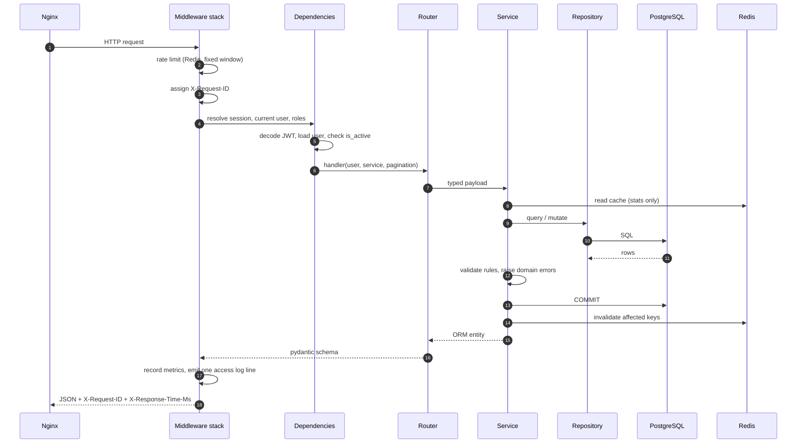
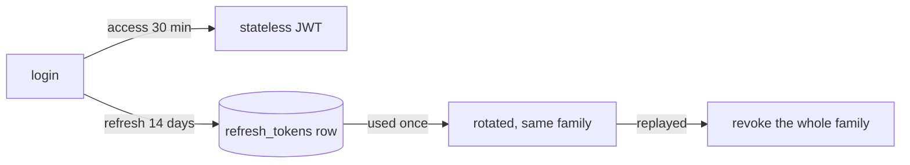

# Architecture

This document explains *why* TaskHub is shaped the way it is. The [README](../README.md)
covers what it does; the [ADR table](../README.md#design-decisions-adr-summary) lists the
decisions in one place.

---

## 1. Layering

```text
        HTTP
         │
┌────────▼──────────────────────────────────────────────────────────┐
│ app/api              routers · dependencies · exception handlers │
│                      · nothing else knows about HTTP status codes │
├──────────────────────────────────────────────────────────────────┤
│ app/services         business rules · transaction boundaries     │
│                      · permission checks · cache invalidation    │
├──────────────────────────────────────────────────────────────────┤
│ app/repositories     every SQL statement in the project           │
│                      · generic CRUD + per-entity queries          │
├──────────────────────────────────────────────────────────────────┤
│ app/models           tables · constraints · indexes · enums       │
└──────────────────────────────────────────────────────────────────┘
        │
     worker (app/workers) reaches the services, never the routers
```

**The rule that keeps it honest:** dependencies point downwards only. A service never
imports `fastapi`; a repository never raises a business error; a router never builds a
query. A reviewer can read one layer and be sure the next one holds no surprises.

What each layer is *not* allowed to know:

| Layer | Must not import | Why |
| --- | --- | --- |
| `api` | `sqlalchemy`, `app.models` | a route should not be able to express SQL |
| `services` | `fastapi`, `starlette` | the same service must work in a Celery worker |
| `repositories` | `fastapi`, `app.schemas` | queries return models, never payloads |
| `models` | everything above | a model is a table description, not behaviour |

The last row is not absolute — `Project.completion_rate` is a computed property — but no
model performs IO.

---

## 2. Request lifecycle



The middleware stack is added bottom-up in `app/main.py`, so the request-id middleware is
the outermost layer and therefore also wraps the rate limiter's own `429` responses.

---

## 3. Transactions

One `AsyncSession` per request, created by `get_session`. **The service layer decides when
to commit**, which is the only place a transaction boundary is visible:

| Operation | Writes | One transaction? |
| --- | --- | --- |
| create project | 1 row + activity log | yes |
| create task | task + activity log + project counters | yes, all three or none |
| complete task | task + activity log + counters | yes |
| delete project | project + every task | yes |
| login | `last_login_at` + refresh token | yes |

The activity log is the one exception: it is written inside a `SAVEPOINT` so a broken
audit row can never roll back (or poison) the business transaction. Getting that wrong was
a real bug during development — a swallowed flush error left the session unusable for the
rest of the request.

### Why the identity map has to stay readable

Under async SQLAlchemy, touching an attribute that SQLAlchemy marked *expired* triggers
lazy IO, which raises `MissingGreenlet`. Two rules follow, and the code obeys them:

1. **Python-side defaults for timestamps.** `TimestampMixin` uses `default=utcnow` in
   addition to `server_default=func.now()`. A server-only value would be expired after
   every flush.
2. **Re-read after commit.** Anything returned to a serializer is fetched again with its
   relationships eager-loaded (`TaskService._reload`), because a commit drops the
   relationship state.

---

## 4. Authentication



* the access token is **stateless** — verification needs no database round trip;
* the refresh token is **stateful** — that is the price of revocation, rotation and
  theft detection;
* only a SHA-256 fingerprint of a refresh token is stored, so a database leak does not
  yield usable sessions;
* `role` is carried in the access token as a *convenience* claim, but the authoritative
  role always comes from the database row, so a demoted user loses access immediately
  rather than when the token expires.

### Error messages

`login()` always runs a bcrypt comparison, even for an unknown e-mail, so response time
does not reveal whether an account exists. Every authentication failure returns the same
message.

---

## 5. Caching

Only one endpoint is cached: `/stats/overview`, which is a dashboard read and the most
expensive query in the application.

* key: `taskhub:stats:<user_id>`, value: the serialised `StatsOverview`, TTL 60 s;
* invalidation is **explicit** — every write path calls `invalidate_pattern`, because
  TTL alone would serve stale numbers for up to a minute after a task was completed;
* the cache is **optional**: with `CACHE_ENABLED=false`, or with Redis unreachable, every
  helper becomes a no-op and the endpoint recomputes;
* a **circuit breaker** (`app/core/cache.py`) stops the process from paying a connection
  timeout on every request while Redis is down.

---

## 6. Rate limiting

Fixed window, `INCR` + `EXPIRE` in one pipeline. A sliding window would be smoother but
needs a sorted set and a Lua script; for abuse prevention the fixed window is enough, and
the cost is one extra request at the boundary of a window.

The limiter **fails open**: if Redis is unavailable, requests are served rather than
rejected. A cache outage must not become an availability outage. `/health/*` and
`/metrics` are exempt, so an orchestrator can always probe a rate-limited service.

---

## 7. Background work

Three queues, one worker:

| Queue | Work | Why separate |
| --- | --- | --- |
| `default` | short jobs from a request | fast, may block the request path |
| `notifications` | e-mail | a slow SMTP server must not stall the worker |
| `maintenance` | beat-driven sweeps | batch work, can be slow |

`app/workers/dispatch.py` is the single entry point for enqueuing. It handles
`task_always_eager` explicitly: in a single-process deployment (and in the test-suite)
tasks run inline, and because they are `async def`, the coroutine has to be awaited by the
caller — `apply_async()` would wrap it in an `EagerResult` and drop it unawaited.

Idempotency matters more than delivery here: the nightly sweep marks each overdue task
with `overdue_notified_at`, so re-running it never mails the same person about the same
task twice.

---

## 8. Observability

| Signal | Mechanism | Consumer |
| --- | --- | --- |
| Logs | `structlog`, JSON in production, `request_id` bound | Loki / ELK |
| Metrics | `prometheus-client` on `/metrics` | Prometheus + Grafana |
| Health | `/health/live`, `/health/ready` | Docker, Kubernetes |
| Errors | optional Sentry DSN | Sentry |
| Audit | `activity_log` table | product / support |

Metric labels use **route templates**, not raw URLs: `path="/api/v1/tasks/{task_id}"`.
Labelling by the raw path would create one time series per task id.

---

## 9. What is deliberately not here

| Missing | Why |
| --- | --- |
| Microservices | one deployable unit is easier to reason about and to review |
| Kubernetes manifests | the Compose stack already answers "how does it run?" |
| Repository pattern over ORM shortcuts | keeps SQL in one place; reviewable in one file |
| DDD aggregates | the domain is three entities deep; aggregates would be ceremony |
| Auto-generated SDK clients | FastAPI's OpenAPI output feeds codegen when needed |

Each of these is a defensible trade-off at this size, not an omission.